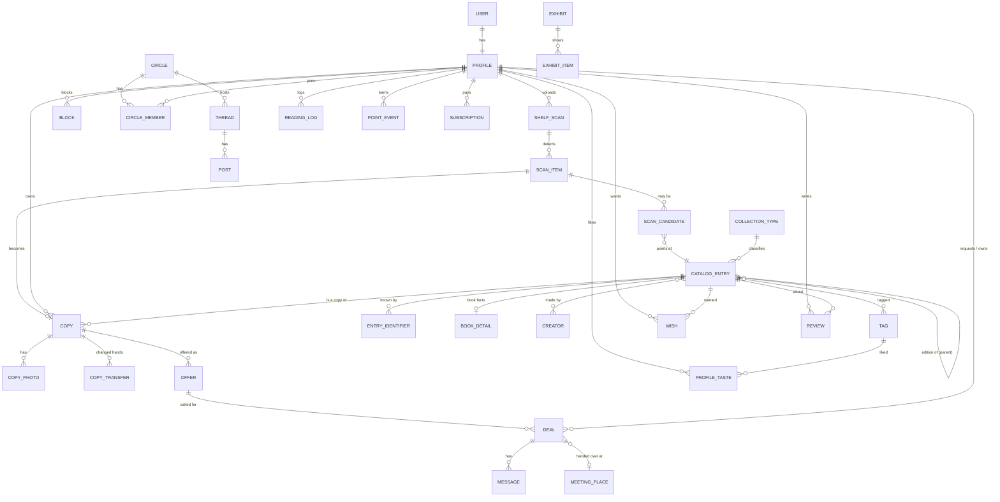

# Books: Data Model

Kickoff step 3 of [building_an_app.md](../building_an_app.md). This is its own
file, separate from [spec.md](spec.md) on purpose, so the shape of the data can
be read alone.

**Status: approved by Avi, 2026-10-18.** All eight decisions in section 10 were
approved as written, and the open free-tier question was answered. The full
spec chapters and the backlog come next. This file stays the living record of
the data and changes as the build learns.

Written 2026-10-18 from Chapter 1 and the brainstorm. Reviewed against the spec
the same day; the review found four gaps (the offer made at confirmation time,
tags for browsing and taste, ownership moving when a book changes hands, and
creators as a model rather than text) and they are fixed in this version.

Every model lives in `books/models.py`. Nothing here touches another app's
tables. The only shared thing is Django's `User`, and the only link to it is
`Profile` (Rule 2).

## 1. How to read this

The models come in four layers, matching the three layers of the app plus a
foundation. The build order is the same: Foundation and Catalog first, then
Hub, then Community. Each model is marked **Phase 1** (catalog, the first
build), **Phase 2** (hub), **Phase 3** (community) or **Later**.

Questions Avi parked earlier are answered here as proposals, so he can approve
or change them. They are marked **[decision]**.

## 2. The picture

## 3. Foundation (generic, so other collections can follow)

### CollectionType . Phase 1
What kind of thing is collected. Today one row: `book`.
- `key` (unique, e.g. `book`, later `coin`), `name_he`, `name_en`
- `condition_scale`: a short name of the grading scale used for copies of this
  type (books use one scale, coins another). The scales themselves are code,
  chosen by this key.

### CatalogEntry . Phase 1
One shared, public record of a thing, the same for everyone. "The book", not
"my book". This is the Discogs and LibraryThing pattern.
- `collection_type` FK
- `title`, `subtitle`, `language`, `year`, `description`
- `creators` many-to-many `Creator` through `EntryCreator` (role: author,
  translator, illustrator, editor; order)
- `tags` many-to-many `Tag`
- `cover_image` (our own copy, never hotlinked)
- `parent` FK to itself, nullable: groups editions under one work
- `source` (which provider or person created it), `confidence_note`
- `created_by` FK Profile, nullable (null when imported)
- `is_verified` (a curator confirmed it)

### Creator . Phase 1
A person or body that made things: an author, a translator, later a mint or an
engraver. A model, not a text column, so "books by this author near me" and
"more by this author" are real queries (Rule 1).
- `name`, `name_he`, `name_en` (whichever are known), `sort_name`
- `source`, `is_verified`
- Alternate spellings: `CreatorAlias` (`creator` FK, `name`), so a Hebrew spine
  and an English record meet on one creator.

### Tag . Phase 1 (on entries), Phase 3 (taste)
Genre, subject, mood, audience. Drives browsing in the hub and recommendations
later. A controlled list, not free text, so two people's "thriller" is one tag.
- `kind` (`genre`, `subject`, `mood`, `audience`, `form`), `key`, `name_he`,
  `name_en`, `parent` FK nullable (sub-genres)
- `collection_type` FK nullable (null means any collection)

### EntryIdentifier . Phase 1
The ways a record can be recognised. Needed because many Israeli books have a
danacode and no ISBN.
- `entry` FK, `scheme` (`isbn13`, `isbn10`, `danacode`, `openlibrary`,
  `googlebooks`, `nli`), `value`
- unique on (`scheme`, `value`)

### BookDetail . Phase 1
Facts only books have, one-to-one with a CatalogEntry of type `book`.
- `entry` 1:1, `publisher`, `pages`, `edition_statement`, `binding`,
  `original_language` (for translations)

Other collections later get their own `*Detail` model, in the same way. No
JSON column is used for this.

## 4. Layer 1: the catalog (Phase 1, the first build)

### Profile . Phase 1
The person, inside Books. One-to-one with the shared `User` (Rule 2).
- `user` 1:1, `display_name`, `language` (he / en)
- `tier` (`free`, `plus`, `pro`): what the person may do (see section 8)
- `area_name` (a neighbourhood or city, free text), `area_lat`, `area_lng`
  (**rounded**, never an address), `radius_km`
- `is_adult_confirmed`, `accepted_terms_at`
- `profile_public` (opt-in, default false), `show_points_public`
- `created_at`

### ShelfScan . Phase 1
One photo of a shelf, and the run that read it.
- `owner` FK Profile, `photo`, `shelf_label` (free text, "living room, top
  shelf"; prefills `location_note` on every copy accepted from this scan)
- `status` (`uploaded`, `reading`, `review`, `done`, `failed`)
- `model_name`, `cost_usd`, `books_found`, `books_accepted`
- `created_at`, `finished_at`
- The photo is kept for the owner only, never shown to anyone else, and
  deleted when the owner asks or deletes the scan. (**[decision]**, question 4.)

### ScanItem . Phase 1
One spine the system found in a scan.
- `scan` FK, `position` (order on the shelf), `crop_image`
- `raw_text` (what was read off the spine; genuinely raw text, the only place
  text stands in for data, and only until the person accepts)
- `review_status` (`pending`, `accepted`, `edited`, `skipped`)
- `copy` FK Copy, nullable (set once the person accepts)

### ScanCandidate . Phase 1
The system's guesses for one spine, best first, so the confirmation screen can
show two or three choices instead of one.
- `item` FK, `entry` FK CatalogEntry, `confidence` (0 to 1), `rank`
- The person's pick becomes the copy's entry. "None of these" leads to search
  or manual entry.

### Copy . Phase 1
One physical item that one person owns. This is "my book". **[decision]**
Entry and copy are separate: three people with the same title share one
CatalogEntry and have three Copies.
- `owner` FK Profile, `entry` FK CatalogEntry
- `location_note` (free text: "box in the closet")
- `condition` (from the type's scale), `notes`
- `visibility`: `private` or `public`. Private is the default.
- `status`: `with_owner`, `on_loan_out`, `transferred`, `lost`
- `is_rare_candidate`, `rarity_note`, `display_only` (shown but never offered)
- `added_via` (`scan`, `manual`, `import`, `received`), `created_at`

**[decision] A copy that changes hands keeps its identity.** When a deal
completes as a sale, a gift or an exchange between two people in the app, the
same `Copy` row gets its `owner` changed to the receiver and `status` back to
`with_owner`; a `CopyTransfer` row records the move. The old owner sees it in a
"given away" list, the new owner sees it in their catalog with its history.
This is what makes provenance possible for the museum. `transferred` is the
status of a copy handed to someone outside the app (no receiving profile).

### CopyTransfer . Phase 2 (the model exists from Phase 1, empty)
- `copy` FK, `from_profile` FK, `to_profile` FK nullable (null when the
  receiver is not in the app), `deal` FK nullable, `kind` (`sold`, `given`,
  `exchanged`), `transferred_at`

### CopyPhoto . Phase 1
Photos of one copy (a copyright page, a signature, damage).
- `copy` FK, `image`, `kind` (`cover`, `copyright_page`, `signed`, `other`)

### Offer . Phase 1 (the declaration), Phase 2 (anyone can act on it)
How a public copy is offered. **[decision]** An offer is its own row, so one
copy can be offered several ways at once (lend and exchange, for example).
"Public, not shareable" is a public copy with no active offer.

Moved to Phase 1 after the review: spec 4 and 5 say the owner makes this choice
while confirming the scanned books, so the row must exist in the first build.
In Phase 1 it is a declaration nobody can act on yet. In Phase 2 the hub reads
it.
- `copy` FK, `kind` (`lend`, `exchange`, `sell`)
- `loan_days` (lend), `price_amount` and `price_currency` (sell, in person)
- `wants_note` (exchange: "I would like a thriller"), `is_active`
- Saving an offer on a private copy is refused: offering implies public.

### Wish . Phase 1 (list), Phase 2 (alerts)
A book a person wants.
- `profile` FK, `entry` FK nullable, `free_text` (when no entry yet)
- `notify_when_available` (bool), `created_at`

## 5. Layer 2: the hub (Phase 2)

### Deal . Phase 2
One person asking for one offered copy, and what happened. Covers lending,
exchange and sale in one model.
- `offer` FK, `copy` FK, `owner` FK Profile, `requester` FK Profile, `kind`
  (`copy` and `owner` are repeated on purpose: after a transfer the copy's
  owner changes, and the deal must still say who owned it then)
- `status`: `requested`, `approved`, `declined`, `cancelled`,
  `handed_over`, `returned`, `completed`, `lost`, `disputed`
- `due_date`, `meeting_place` FK nullable, `meeting_note`
- `owner_confirmed_handover_at`, `requester_confirmed_handover_at`
- `returned_confirmed_at`, `created_at`
- For an exchange: `swap_copy` FK Copy, nullable (the book coming back). On
  completion both copies get a `CopyTransfer`.

Points and reputation are given only when **both** sides confirm, as the
research advised.

### Message . Phase 2
In-app messages inside a deal.
- `deal` FK, `sender` FK Profile, `body`, `created_at`, `read_at`

### Block . Phase 2
One person stopping another from contacting them. A blocked person cannot
request, message or see the blocker's copies.
- `blocker` FK Profile, `blocked` FK Profile, `created_at`; unique pair

### MeetingPlace . Phase 2
Named handover points (cafes, libraries, bookshops).
- `name`, `kind`, `area_name`, `lat`, `lng` (the place's, not a person's)
- `is_partner`, `notes`, `is_active`

### Notification . Phase 2
- `profile` FK, `kind`, `deal` FK nullable, `entry` FK nullable
- `read_at`, `created_at`

## 6. Layer 3: the community (Phase 3, Circle in Phase 2)

### Circle . Phase 2
A group of people. The first launch is one cluster (spec 12.1), so this comes
with the hub, not after it. A book club, a school, a workplace, a
neighbourhood. A circle is also the cohort for a leaderboard.
- `name`, `kind`, `area_name`, `join_code`, `is_private`, `created_by`
### CircleMember . Phase 2
- `circle` FK, `profile` FK, `role` (`member`, `moderator`, `owner`), `joined_at`

### Thread, Post . Phase 3
Forums and blogs are one structure with a `kind`.
- Thread: `kind` (`discussion`, `blog`, `report`), `circle` FK nullable (null
  means open to all), `author`, `title`, `entry` FK nullable (about one book),
  `is_locked`, `created_at`
- Post: `thread` FK, `author`, `body`, `status` (`visible`, `hidden`),
  `created_at`. The first post of a `blog` or `report` thread is the piece
  itself; later posts are comments.

### Review . Phase 3
A short opinion of a book. Longer analysis is a `report` thread.
- `profile` FK, `entry` FK, `rating` (1 to 5), `body`, `has_spoilers`
- unique on (`profile`, `entry`)

### ReadingLog . Phase 3
What a person says they read, on trust.
- `profile` FK, `entry` FK, `status` (`want`, `reading`, `read`, `dnf`)
- `started_on`, `finished_on`, `note`

### ReadingCheckin, StreakFreeze . Phase 3
One row per day the person logged reading. The streak is **computed** from
these, not stored.
- ReadingCheckin: `profile` FK, `day`, `minutes` nullable. Unique on
  (`profile`, `day`).
- StreakFreeze: `profile` FK, `used_on`

### ProfileTaste . Phase 3
What a person likes, per tag, for recommendations. Filled from an onboarding
survey and from the person's own catalog and logs.
- `profile` FK, `tag` FK, `weight` (-1 to 1), `source` (`survey`, `derived`)
- unique on (`profile`, `tag`)

### PointEvent . Phase 3
**[decision]** Points are a ledger: one row per award, and the total is the
sum. Nothing is overwritten, so cheating can be audited and undone.
- `profile` FK, `kind` (`handover_confirmed`, `returned_on_time`, `review`,
  `report`, `catalog_confirm`), `points`
- `deal` FK, `review` FK, `thread` FK, all nullable (what earned it),
  `created_at`
- Unique on (`profile`, `kind`, `deal`) so one deal is paid once. The same two
  people and the same copy earn nothing a second time. `catalog_confirm` is
  capped per day so rescanning a shelf earns nothing.

### Badge, ProfileBadge . Phase 3
- Badge: `key`, `name_he`, `name_en`. ProfileBadge: `profile`, `badge`, `earned_at`.

### Exhibit, ExhibitItem . Later (the museum)
- Exhibit: `title`, `text`, `curator` FK Profile, `is_published`
- ExhibitItem: `exhibit` FK, `copy` FK nullable, `entry` FK nullable, `note`,
  `provenance` (drawn from `CopyTransfer` where it exists), `rights_statement`

### Report . Phase 2 (copies and profiles), Phase 3 (posts and reviews)
A report button for anything.
- `reporter` FK, one nullable FK each to `post`, `review`, `copy`,
  `profile`, `reason`, `status`, `handled_by`, `created_at`

## 7. Money (Later, room left now)

### Subscription . Later
- `profile` FK, `tier`, `started_at`, `ends_at`, `provider`,
  `provider_reference`, `status`
`Profile.tier` is what the rest of the app checks. The first experiment runs
with no billing, so tiers are set by hand.

Advanced-tier content (a person's own books, scans, narrations) gets its own
models later, after the legal footing (spec 12.10) is settled. They are not in
this model.

## 8. What each tier can touch (proposal)

| Thing | Free | Plus | Pro |
| --- | --- | --- | --- |
| ShelfScan, ScanItem, Copy, Offer (declare), Wish (up to 1,000 copies) | yes | yes | yes |
| See that another book exists nearby (no names) | yes | yes | yes |
| Deal, Message: start a request or a contact | no | yes | yes |
| Deal, Message: answer a request a subscriber sent | yes | yes | yes |
| Circle, threads, Review, ReadingLog, points | no | yes | yes |
| Better recognition (full catalogue match, more candidates) | basic | full | full |
| Own books, scans, narration | no | no | yes |

The 1,000-copy cap counts copies with status `with_owner` or `on_loan_out`
(**[decision]**, question 6: books the person still has, not every book ever
added). A free person **can reply** to a request a subscriber sends, but cannot
start one (Avi, 2026-10-18): it grows the network without giving the hub away.

## 9. Rules the data enforces

- A **Copy is private by default.** Only the owner ever sees a private copy.
  The API never returns another person's private copy, and a test pins it.
- **An offer implies public.** No offer can exist on a private copy.
- **Location is never an address.** `area_lat` and `area_lng` are rounded when
  saved, so a precise point is never stored.
- **Recognition is a guess until a person accepts it.** A ScanItem never makes
  a Copy by itself. Accepting a candidate does.
- **A copy changes owner only through a completed deal** with both sides
  confirmed, and every change leaves a `CopyTransfer`.
- **No raw reading history is shown** unless `profile_public` is on.
- **A blocked person gets nothing**: no copies, no requests, no messages.
- **Book data is copied into our own CatalogEntry**, never read live from one
  provider (spec 12.14).
- **No JSON as data.** No model keeps real data in a text or JSON field
  (Rule 1). Creators and tags are tables. Facts that differ by collection type
  get their own detail model.

## 10. Decisions for Avi

Proposed in this file, marked **[decision]** above:

1. **Offers as separate rows,** and the offer is declared in Phase 1 during
   confirmation. One book can be offered to lend and to exchange at once.
2. **Entry versus copy.** Everyone shares one record per book and owns their
   own copy.
3. **A copy keeps its identity when it changes hands** (same row, new owner,
   a transfer record).
4. **Shelf photos** are kept for the owner only and deleted on request.
5. **Circle is Phase 2,** with the hub.
6. **The 1,000 cap** counts books the person still has.
7. **Points as a ledger.**
8. **First build** is Foundation plus Catalog: CollectionType, CatalogEntry,
   Creator, Tag, EntryIdentifier, BookDetail, Profile, ShelfScan, ScanItem,
   ScanCandidate, Copy, CopyPhoto, Offer (declaration only), Wish.

**All eight approved by Avi on 2026-10-18, as written.**

## 11. Additions made during the build (acked by Avi, 2026-10-18)

Recorded here the day they were built, as the methodology asks. Each is a
small model the approved picture did not have; none changes an approved one.

**Profile.theme, Profile.palette, Profile.shelf_view** (SPR-BK1.6, spec BK1
§1.1b). The person's appearance choices: `theme` light / dark / system,
`palette` lamplit / warm / bright / den, `shelf_view` lamp / bookcase /
living. Defaults are the ones Avi chose.

**Job** (SPR-BK1.5). One unit of background work, so no page waits on a
model: `kind`, `ref_id` (the row it works on), `profile` (nullable),
`status` queued / running / done / failed, `attempts`, `error`, timestamps.
A thread runs it; a token endpoint and a command re-run anything dropped.

**ModelCall** (SPR-BK1.5, spec BK1 §1.6 "every model call is costed"). One
paid model call: `profile`, `job` (both nullable), `provider`, `model`,
`purpose`, `input_tokens`, `output_tokens`, `cost_usd`, `duration_ms`, `ok`,
`created_at`. Cost per scan and per person are sums over this table.

**Storage** is not a model: images live in Books' own private GCS bucket
(`books/` prefix, signed links) or, until ACT-BK.6, under `media/books/`.

**CreatorAlias** (SPR-BK2.1). Another spelling of the same person (`creator`,
`name`, `search_name`), so a Hebrew spine and an English record meet on one
creator. Replaces the one-line mention under Creator with a real table.

**CatalogEntry.merged_into, CatalogEntry.search_text, Creator.search_name,
CreatorAlias.search_name** (SPR-BK2.3, 2.4). `merged_into` is how a duplicate
points at its winner after a curator merges, so old links still resolve;
the `search_*` columns hold the normalised text (no vowel marks, no final
letters, no quotes, lower case) that search and matching compare on.

**EntryCorrection** (SPR-BK2.4). A reader's suggestion that a record is
wrong: `entry`, `profile`, `field`, `value`, `note`, `status` open / accepted
/ declined, `handled_by`, timestamps. A curator's accept changes the record.

**EntryIdentifier.scheme** gained the provider schemes `openlibrary`,
`googlebooks`, `nli`, so a source record is recognised on a second import.

**BK3 additions (2026-10-19, for Avi's ack).** `ShelfScan` gains `error`,
`seconds`, `default_visibility` and `default_offers` (the choices every book
of the scan starts with). `ScanItem.raw_text` is split into `raw_title` and
`raw_author` (the reader returns them apart), plus `added_by_hand` for a book
the photo missed; `ScanItem.crop_image` is not built, because the reader
returns titles in shelf order, not positions. `Copy.position` is the order
on the person's shelf (the living shelf's drag). `Offer` is unique per copy
and kind.

**BK5 additions (2026-10-19, for Avi's ack).** `Profile.phone`, private,
shown to the other side of one deal only when its owner ticks it there (Avi:
more ways to talk after approval). `Deal` gains `loan_days` and
`price_amount` (copied from the offer when asked, so a later change to the
offer does not change a deal in progress), `requester_marked_returned_at`
(the borrower says "I returned it"; the owner's confirmation still decides),
`returned_late`, `owner_shares` / `requester_shares` (which ways to talk each
side opened: phone, WhatsApp, email), `closed_note` (why it was cancelled or
disputed), `reminded` (which reminders went out, so each goes once) and
`updated_at`. `Notification` gains `copy` (for "a book you wished for is
offered near you"); its words come from the catalogue by `kind`, never
stored text. `Report` gains `deal`, `status` open / handled and `handled_by`.
`MeetingPlace`, `Deal`, `Message`, `CopyTransfer`, `Block`, `Notification`
and `Report` are otherwise as approved above (migration 0007).

**BK6 additions (2026-10-19, for Avi's ack).** `Circle` and `CircleMember`
are as approved, plus `Circle.description` and `created_at`. `Feedback` is
new: `profile`, `path` (the page it was written on), `body`, `status` open /
read, `created_at`; it is the in-app feedback of spec BK6 and reaches only
the pilot desk. `MeetingPlace.circle` (nullable) makes a place a circle's
own; empty means everyone's (migration 0008).

**BK7 additions (2026-10-19, for Avi's ack).** `Thread`, `Post`, `Review`
and `ReadingLog` are as approved, plus: `Thread.is_pinned` and
`last_post_at` (the list's order); `Post.hidden_by` and `edited_at`;
`Review.status` visible / hidden and `updated_at`; `Notification.thread`
(a new comment on your thread); `Report.post` and `Report.review` (the
Phase 3 columns of the approved Report); `Profile.public_library`,
`public_reading`, `public_reviews`, each an opt-in on its own under the
profile switch (spec 12.9). Migration 0009.

**BK8 additions (2026-10-20, for Avi's ack).** `ReadingCheckin`,
`StreakFreeze`, `PointEvent`, `Badge` and `ProfileBadge` are as approved,
plus: `StreakFreeze.earned_at`; `PointEvent.entry` (the book that earned a
once-per-book award), `note`, `reversed_at` and `reversed_by` (an award is
reversed, never deleted) and an `adjustment` kind; the unique (`profile`,
`kind`, `deal`) applies only when a deal is set; `Badge.about_he` /
`about_en`; `Notification.badge` and `Notification.scan` (the bell for a
badge and for a shelf read or failed, migration 0010). Migration 0011.

**BK9 additions (2026-10-20, for Avi's ack).** `ProfileTaste` as approved,
with its unique widened to (`profile`, `tag`, `source`): the survey and the
derived taste are kept apart and combined when read, so recomputing one
never erases the other. `EntryTagging` is new: one row per record saying
how it got its tags (`source` model / curator, `model_name`, `confidence`,
`raw` answer for audit, `tagged_at`); a curator row stops the model.
Migration 0012.

**Web lookup addition (2026-10-20, Avi asked for it).** `WebLookup`: one
web search for one book as read from a spine, kept so it is never searched
twice by anyone: `key` (normalised title and author, unique), `title`,
`author`, `found`, `result` (the answer, for audit), `source_url`, `entry`
(the record it produced), `searches`, `cost_usd`, `created_at`. A record it
produces has `source` "web". Migration 0013.
