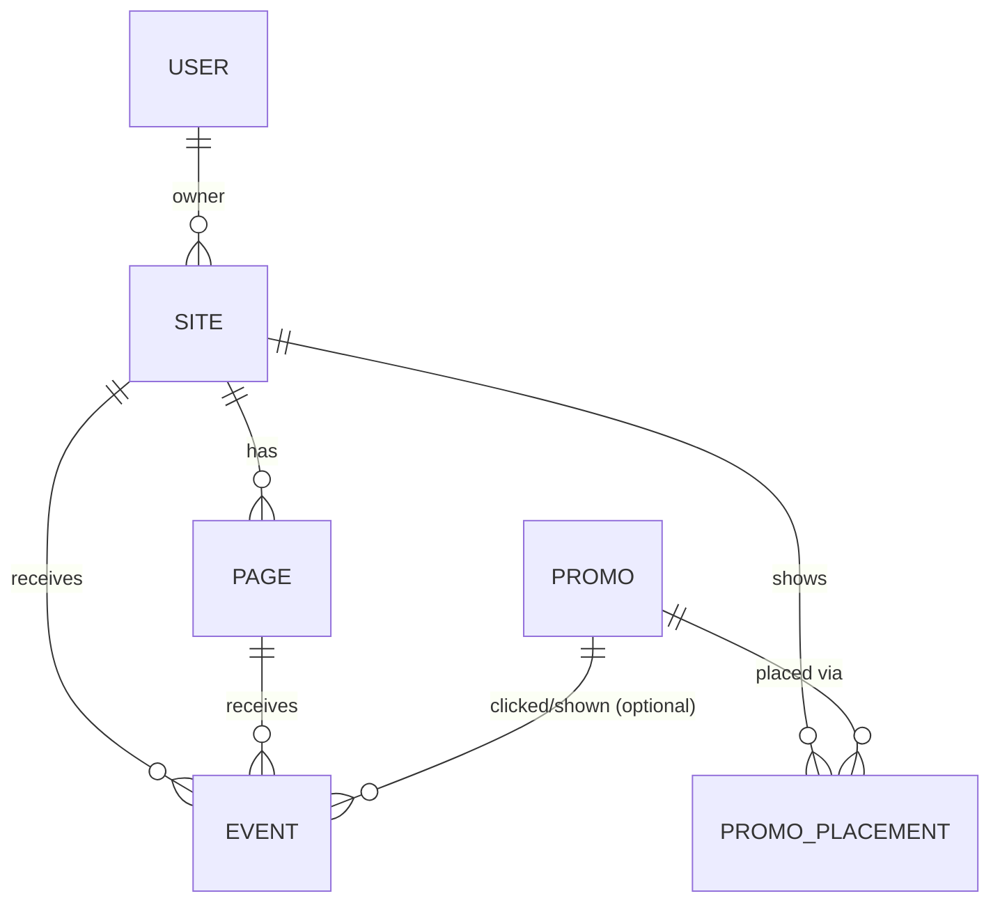

# counter: Data Model

Standalone data model (kickoff step 3). Awaiting Avi's approval before the full
spec. All models live in `counter/models.py`. Nothing touches another app's
models; the only shared thing is the Django `User`, and only to say who owns a
site.

## Models

### Site
One tracked site (a GitHub Pages repo, or a section of babook).
- `owner` FK User (Avi; makes later sharing possible)
- `name` (e.g. "avisalmon.github.io/arduino-notes")
- `key` unique, public, random, goes in the snippet
- `base_url` (informational, used by the snippet generator)
- `repo` (optional text, "owner/name", for the phase 3 workflow)
- `local_path` (optional text, checkout on Avi's PC)
- `is_active`, `created_at`
- `snippet_installed_at` (nullable, set when phase 3 wires the site)

### Page
One URL path within a site, created automatically on first hit.
- `site` FK, `path` (normalised, no query string), `title` (last seen)
- unique (`site`, `path`)
- `first_seen`, `last_seen`

### Event
One row per thing that happened. Single table for views, clicks and custom
interactions.
- `site` FK, `page` FK (nullable)
- `kind`: `view` | `click` | `custom` | `promo_shown` | `promo_click`
- `name` (for custom: e.g. "download", else blank)
- `visitor_id` (random id from the browser, blank if absent; drives uniques)
- `ip_hash` (optional, salted hash, nullable; low priority, never raw IP)
- `referrer`, `user_agent` (short, truncated)
- `promo` FK nullable
- `created_at` indexed together with `site` and `kind`

### Promo
One of Avi's own apps or features to advertise.
- `title`, `text`, `url`, `image_url` (optional)
- `is_active`, `created_at`

### PromoPlacement
Which promo shows where.
- `promo` FK, `site` FK
- `path_prefix` (blank = whole site), `weight` int (default 1)
- `is_active`

## Statistics (no model)

Computed from `Event` by plain queries, not stored: totals, uniques
(`distinct visitor_id`), per page, per day, top pages, promo click rate. If
queries get slow later we add a `DailyStat` rollup then, not now.

## API (DRF, full CRUD per Rule 6)

- Public, key-based, write and read-light: `POST /counter/api/hit/`,
  `GET /counter/api/stats/<key>/` (counts for the site or one page),
  `GET /counter/api/promo/<key>/?path=...`
- Owner only, full CRUD: sites, pages, events (read and delete), promos,
  placements, plus a stats endpoint for the dashboard.

## Open questions for Avi

1. Is one `Event` table for everything fine? It is simplest and easy to query.
2. Is `visitor_id` plus an optional `ip_hash` OK for uniques, never storing a
   raw IP?
3. Should a page's public count endpoint return only totals, or also uniques?
   (I suggest both.)
