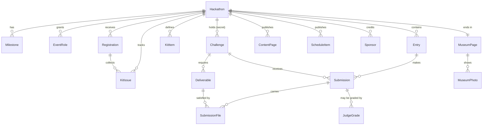
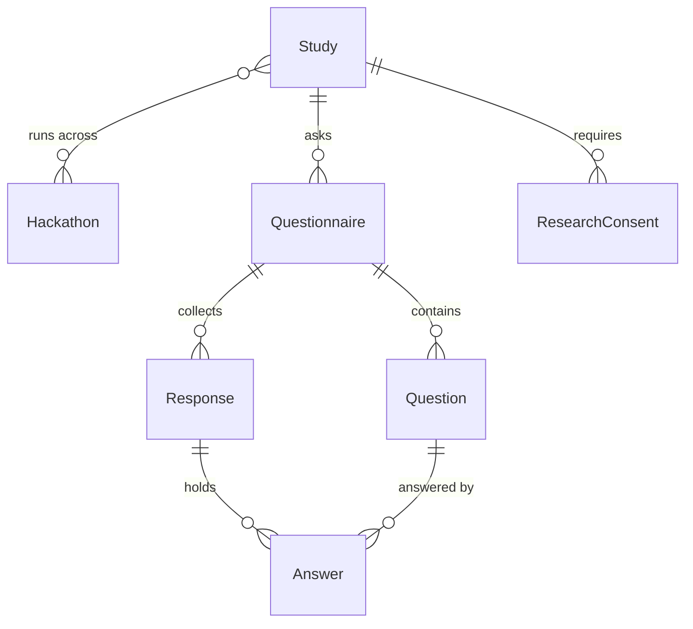

# CrashTech — data model

> **This is the approval gate.** Per the kickoff sequence in
> [building_an_app.md](../building_an_app.md), the data model is written on
> its own and waits for approval before the full spec or any code. It does
> not have to be final. It has to be understandable, and it has to make the
> shape of the thing arguable.
>
> Django app label: `crashtech`. Own models, own migrations from `0001`.
> The only thing shared with the rest of the site is `auth.User`, for
> sign-in and nothing else (Rule 2).

Companion to [spec.md](spec.md) chapter 1. Where this document and that
one disagree, this one is newer.

---

## The shape in one picture

---

## 1. The event and its milestones

### Hackathon

One event. The root of everything.

| Field | Type | Notes |
| --- | --- | --- |
| `name` | CharField | "CrashTech VLSI 2027" |
| `slug` | SlugField, unique | auto from name, stable forever since the museum page lives at it |
| `tagline` | CharField, blank | one line for the public page |
| `status` | choice | `setup` / `published` / `kits` / `live` / `closed` / `museum`. See below |
| `starts_at` / `ends_at` | DateTime | the 24 hours themselves |
| `submission_deadline` | DateTime | separate from `ends_at` on purpose: submissions can close before the event does |
| `entry_mode` | choice | `individual` (default) / `pairs`. **An admin setting, and the only two values there are.** Never three, never "teams" |
| `repo_url` | URLField, blank | pointer to the supporting repo: examples, skills, methodology. **A URL and nothing more**, so a repo reused across several events costs nothing and a fresh one per event is equally fine. Never holds challenges |
| `timezone` | CharField | an event is a physical place; a UTC-only model gets the pickup day wrong |
| `leaderboard_visibility` | choice | `admins` (default) / `participants` / `public`. **A setting, not a policy**: an admin opens the board up when they want to, including onto a screen in the room, and it stays shut otherwise |
| `created_at` | DateTime | |

**Status is the spine.** Every surface in the app gates on it, and it is the
one piece of the 2026 platform that survives untouched because it was right.

| Status | What is true |
| --- | --- |
| `setup` | Nothing is public. Tech lead authors challenges, admin configures. |
| `published` | Milestone 1. The event page is public, sign-up is open, challenges invisible. |
| `kits` | Milestone 2. Hardware is being handed out, the supporting repo is open, challenges still invisible. |
| `live` | Milestone 3. Entering this state **makes every challenge visible at once**. Submissions accepted. |
| `closed` | Milestone 4. Submissions locked. Judging and verification. |
| `museum` | Milestone 5. Permanent and public. Terminal. |

### Milestone

Milestones were narrative until a questionnaire needed to attach to one.
Now they are rows.

| Field | Type | Notes |
| --- | --- | --- |
| `hackathon` | FK | CASCADE |
| `kind` | choice | `publication` / `hardware` / `kickoff` / `close` / `museum`, plus `custom` |
| `title` | CharField | shown to people; "Kit pickup day" |
| `occurs_at` | DateTime | **this is where the hardware pickup date lives** |
| `order` | int | |
| `blurb` | TextField, blank | what happens at this moment |

Why this exists rather than four more date fields on `Hackathon`: a
questionnaire attaches to a milestone (§8), the public page lists them as a
timeline, and the calendar export (§4) is a loop over them. Fixed dates
could not carry any of that. The gap between any two is whatever the dates
say, so "two weeks, or one week, or three days" needs no special support.

---

## 2. People and roles

### EventRole

A role grant, scoped to one event. A person may hold several on one event
and different ones across events.

| Field | Type | Notes |
| --- | --- | --- |
| `hackathon` | FK | CASCADE |
| `user` | FK `auth.User` | CASCADE. The one shared thing (Rule 2) |
| `role` | choice | `tech_lead` / `admin` / `judge` / `participant` / `researcher` |
| `granted_by` | FK User, null | who let them in |
| `created_at` | DateTime | |

Unique on (`hackathon`, `user`, `role`).

**`tech_lead` and `admin` are separate, and that is the main structural
change from 2026**, where one "organizer" owned both the challenges and the
logistics. They are different people doing different jobs: one defines the
hardware, the example, the secret challenges and the judging criteria; the
other handles sign-ups, kits, announcements and process.

### Registration

**New.** In 2026 a participant was *invited* by an organizer. Milestone 1
says people sign up themselves, so applying and being accepted are two
different events and need somewhere to live.

| Field | Type | Notes |
| --- | --- | --- |
| `hackathon` | FK | CASCADE |
| `user` | FK User | CASCADE |
| `status` | choice | `applied` / `accepted` / `declined` / `withdrawn` |
| `applied_at` | DateTime | |
| `decided_at` / `decided_by` | DateTime / FK User, null | |
| `note` | TextField, blank | what they wrote when applying, or why they were declined |

Unique on (`hackathon`, `user`). Accepting a registration is what grants the
`participant` `EventRole`; the two are kept apart so "who asked" survives
independently of "who is in".

### Entry

**An entry is one participant, or two.** Never more. Whether pairs are
allowed at all is `Hackathon.entry_mode`, which an admin sets per event.

| Field | Type | Notes |
| --- | --- | --- |
| `hackathon` | FK | CASCADE |
| `name` | CharField, blank | optional. A pair may name itself; a solo entry usually will not |
| `members` | M2M User | **one or two rows, enforced against `entry_mode`** |
| `anon_ordinal` | int | stable anonymous label for blind judging: "Entry 7" |
| `exhibition_consent` | bool | for the museum, captured up front, revocable after |
| `created_at` | DateTime | |

**There is no captain and no hierarchy.** Both members of a pair hold every
authority there is: either may submit, either may upload, either may change
anything the entry owns. This was explicit, and it removes a field, a
permission check, and an argument at 4am.

**Why an entry still exists as a model when most of them are one person.**
It would be possible to attach submissions straight to a participant and
give them an optional partner. That choice pushes a branch into every
downstream thing: the leaderboard, certificates, blind judging, the museum
would each need to know whether they are looking at a person or a pair.
Keeping one model, where **a solo participant is simply an entry of one**,
means none of them ever ask.

**Individual behaviour survives pairing.** You want to research individuals,
and an entry of two could have hidden who did what. It does not:
`Submission.submitted_by` records the individual who acted, `ResearchConsent`
is per user, and questionnaire responses are per user. The entry is how work
is scored; the person is how behaviour is measured, and those stay separate
on purpose.

---

## 3. Hardware

Entirely new. The 2026 platform had one integer, `hardware_stock`, and a
three-state flag on the team. It could not express *what* the hardware was,
so it could never be swapped for a Raspberry Pi.

### KitItem

What the kit is made of, **defined by the tech lead per event**.

| Field | Type | Notes |
| --- | --- | --- |
| `hackathon` | FK | CASCADE |
| `name` | CharField | "Intel DE10-Lite", "ESP32-WROOM-32", "SSD1306 OLED" |
| `description` | TextField, blank | markdown |
| `image` | ImageField, blank | |
| `quantity_total` | int | how many exist |
| `is_returnable` | bool | a dev board comes back, a jumper wire does not |
| `order` | int | |

The event's kit is simply its list of `KitItem`s. Next year that list says
Raspberry Pi and nothing in the code changes.

### KitIssue

Handing one out and confirming it arrived.

| Field | Type | Notes |
| --- | --- | --- |
| `hackathon` | FK | CASCADE |
| `registration` | FK Registration | **who receives it: a person, not a team** |
| `item` | FK KitItem, null | null means "the whole kit" |
| `status` | choice | `reserved` / `collected` / `returned` / `lost` |
| `collected_at` | DateTime, null | |
| `confirmed_by` | FK User, null | **the admin who approved receipt** |
| `note` | TextField, blank | |

**A kit is issued to a person, not a team**, and is **collected in person**.
Both decided, and they fit the event's shape: **the event is built around
individuals.** A person registers, a person collects a kit, a person
practises. Pairing, where an admin allows it at all, happens later and
changes nothing about the hardware.

The FK is to `Registration` rather than straight to `User` because it
carries the event with it, and because you cannot be issued a kit for an
event you never registered for. That is a constraint the database enforces
rather than a rule a view has to remember.

Sizing follows: `KitItem.quantity_total` is measured against **accepted
registrations**. The 2026 platform computed availability as
`stock - teams.count()`, which is now the wrong arithmetic by a factor of
the entry size.

**No shipping.** Kits are handed over at a place on a date. International
means the audience is international and travels to the event; it does not
mean posting FPGA boards across borders, with the addresses, tracking and
customs that would require. If that ever changes, `KitIssue` grows a
delivery method and `Registration` grows an address, and nothing else
moves.

---

## 4. Content: the static site, absorbed

The 2026 site was eight sections of hand-written HTML. What survives into
the database is only what is **specific to this event and not in the repo**:
what the event is, its rules, its schedule, its sponsors. The consequence is
the one that matters: **running the next event needs no developer.**

### ContentPage

| Field | Type | Notes |
| --- | --- | --- |
| `hackathon` | FK | CASCADE |
| `slug` | SlugField | `about`, `rules`, `venue`, `faq`. **Not** `hardware` or `get-started`: those are the repo's |
| `title` | CharField | |
| `body` | TextField | markdown |
| `visible_from` | choice, null | the milestone kind it appears at; null means always |
| `order` | int | |
| `published` | bool | |

**Deliberately narrow.** The 2026 site had eight sections; only some become
`ContentPage` rows. What the event is, the rules, how to register, and
anything else specific to *this* event lives here. The hardware guide, the
setup checklist, the AI tooling guidance and the practice projects do
**not**: they live in the supporting repo, and the system links to it
rather than restating it. One source, so the two cannot drift apart.

### ScheduleItem

Structured rather than prose, because it drives the calendar.

| Field | Type | Notes |
| --- | --- | --- |
| `hackathon` | FK | CASCADE |
| `title` | CharField | "FPGA Installation Party" |
| `description` | TextField, blank | |
| `starts_at` / `ends_at` | DateTime / DateTime null | |
| `location` | CharField, blank | |
| `order` | int | |

Milestone 1 said people get a calendar. The ICS export is a loop over
`Milestone` plus `ScheduleItem`, which is why both are structured and
neither is a paragraph of markdown.

### Sponsor

| Field | Type | Notes |
| --- | --- | --- |
| `hackathon` | FK | CASCADE |
| `name` | CharField | |
| `logo` | ImageField | |
| `url` | URLField, blank | |
| `tier` | CharField, blank | "platinum", or blank if tiers are not used |
| `order` | int | |

The 2026 site carried ten logos as static files. Per event, because next
year's sponsors are next year's problem.

## 5. Challenges

### Challenge

| Field | Type | Notes |
| --- | --- | --- |
| `hackathon` | FK | CASCADE |
| `title` | CharField | |
| `brief` | TextField | markdown, the full task |
| `kind` | choice | `completion` / `measured` / `creativity`. The three you described |
| `points` | int | what `completion` is worth |
| `visible` | bool | **false until kickoff.** Carried over unchanged |
| `order` | int | |
| `created_by` | FK User, null | the tech lead |

**Measured challenges** (the one real product change from the 2026
feedback) add:

| Field | Type | Notes |
| --- | --- | --- |
| `metric_name` | CharField, blank | "Fmax", "logic elements", "cycles" |
| `metric_unit` | CharField, blank | "MHz", "count", "ms" |
| `metric_direction` | choice | `higher_is_better` / `lower_is_better` |
| `rank_points` | JSONField | points by finishing position, e.g. `[50, 30, 20, 10]` |

**Creativity challenges** add:

| Field | Type | Notes |
| --- | --- | --- |
| `max_grade` | int | what a judge may award |
| `criteria` | TextField, blank | what the judges are told to look for |

A measured challenge ranks entries by their reported number and pays by
position. A creativity challenge pays by human grade. A completion
challenge pays a flat `points` on self-report. They are one model with three
modes rather than three models, because a submission is the same shape in
all three cases.

### Deliverable

**New, and one of the two most important additions.** You said each task
defines in advance what has to be uploaded. In 2026 every submission had
exactly one zip field, identical for every challenge.

| Field | Type | Notes |
| --- | --- | --- |
| `challenge` | FK | CASCADE |
| `label` | CharField | "Quartus project", "ESP32 firmware", "Demo video" |
| `purpose` | choice | `proof` (it worked) / `artifact` (how it was built) |
| `kind` | choice | `video` / `image` / `text` / `number` / `file` |
| `required` | bool | |
| `help_text` | CharField, blank | |
| `order` | int | |

Because the requirement is declared, the system can tell an entry what is
still missing **before** they submit. That saves a judge an argument at 3am
and costs nothing.

---

## 6. Submissions, and the trust model

### Submission

| Field | Type | Notes |
| --- | --- | --- |
| `challenge` | FK | CASCADE |
| `entry` | FK Entry | CASCADE |
| `submitted_by` | FK User, null | who pressed it |
| `reported_value` | DecimalField, null | **the measured number the entry reports** |
| `reported_note` | TextField, blank | the text result, or how they got it |
| `claimed_complete` | bool | for `completion` challenges |
| `tentative_points` | int | **awarded immediately, on trust** |
| `final_points` | int, null | set when results are confirmed; null until then |
| `verification` | choice | `unverified` / `verified` / `disputed` / `withdrawn` |
| `verified_by` / `verified_at` | FK User null / DateTime null | the spot check |
| `verification_note` | TextField, blank | |
| `created_at` / `updated_at` | DateTime | |

Unique on (`challenge`, `entry`).

**This is the inversion from 2026 and the single most important behavioural
decision in the model.** The old `Submission` started `pending` with zero
points and waited for a judge to approve before it scored anything. This one
**scores on submission** and treats verification as a later, optional,
narrow act aimed only at the scores that decide the outcome. `verification`
defaults to `unverified` and that is a normal, final, respectable state for
the great majority of submissions. Nothing blocks on a judge.

### SubmissionFile

| Field | Type | Notes |
| --- | --- | --- |
| `submission` | FK | CASCADE |
| `deliverable` | FK Deliverable | which requirement this satisfies |
| `file` | FileField, null | |
| `text_value` | TextField, blank | for `text` and `number` deliverables |
| `url` | URLField, blank | a YouTube link instead of an upload |
| `uploaded_at` | DateTime | |

Deleting a row deletes its file. memz learned this the expensive way: every
delete path left the bytes on a 1 GB shared disk, and video is far bigger
than a meme.

### UploadToken

Carried over from 2026 because it solves a real problem: a phone filming a
demo at 3am should not have to log in.

| Field | Type | Notes |
| --- | --- | --- |
| `entry` | FK Entry | CASCADE |
| `challenge` | FK Challenge | CASCADE |
| `token` | CharField, unique | in the QR code |
| `expires_at` | DateTime | |

---

## 7. Judging, results, museum

### JudgeGrade

Creativity challenges need a human number, and more than one judge may
grade the same submission.

| Field | Type | Notes |
| --- | --- | --- |
| `submission` | FK | CASCADE |
| `judge` | FK User | CASCADE |
| `grade` | int | |
| `note` | TextField, blank | |
| `created_at` | DateTime | |

Unique on (`submission`, `judge`).

### The leaderboard is not a model

It is computed from submissions, exactly as memz computes its podium from
votes. A stored total is a second source of truth for a number that is only
ever read, and it goes stale the moment a verification changes a score.

### Certificate

| Field | Type | Notes |
| --- | --- | --- |
| `hackathon` / `entry` | FK / FK | |
| `type` | choice | `participation` / `winner` / `runner_up` |
| `cert_id` | UUID, unique | the public link |
| `generated_at` | DateTime | |

### MuseumPage and MuseumPhoto

| MuseumPage | Type | Notes |
| --- | --- | --- |
| `hackathon` | OneToOne | |
| `published` | bool | |
| `highlights` | TextField | markdown |
| `published_at` | DateTime, null | |

| MuseumPhoto | Type | Notes |
| --- | --- | --- |
| `museum_page` | FK | CASCADE |
| `image` | ImageField | |
| `caption` | CharField, blank | |
| `order` | int | |

The exhibition of projects is **computed**, not stored: the submissions of
entries that gave `exhibition_consent`. No separate table, and revoking
consent removes the work from display without deleting anything.

---

## 8. Research

The part with the most care in it, because it is about people.

### Study

| Field | Type | Notes |
| --- | --- | --- |
| `title` | CharField | |
| `description` | TextField | what is being studied |
| `researchers` | M2M User | |
| `hackathons` | M2M Hackathon | **a study spans events**, which is how behaviour across events gets compared |
| `consent_text` | TextField | what a participant agrees to, in full |
| `consent_version` | CharField | changing the terms must not silently reuse old consent |
| `ethics_reference` | CharField, blank | the Technion approval, when there is one |
| `is_active` | bool | |

Note that `Study` is **not** a child of `Hackathon`. Everything else in this
model belongs to one event; a study deliberately does not, because the
research question is about events plural.

### Questionnaire, Question, Response, Answer

| Questionnaire | Type | Notes |
| --- | --- | --- |
| `study` | FK | CASCADE |
| `milestone_kind` | choice | **when it is asked.** The reason `Milestone` is a model |
| `title` / `intro` | CharField / TextField | |
| `is_open` | bool | |

| Question | Type | Notes |
| --- | --- | --- |
| `questionnaire` | FK | CASCADE |
| `text` | TextField | |
| `kind` | choice | `text` / `scale` / `single_choice` / `multi_choice` / `number` |
| `choices` | JSONField | for the choice kinds |
| `required` | bool | |
| `order` | int | |

| Response | Type | Notes |
| --- | --- | --- |
| `questionnaire` | FK | CASCADE |
| `hackathon` | FK | which event this answer came from |
| `user` | FK User, null | **null when the study is anonymised** |
| `submitted_at` | DateTime | |

| Answer | Type | Notes |
| --- | --- | --- |
| `response` | FK | CASCADE |
| `question` | FK | |
| `value` | TextField | |

### ResearchConsent

| Field | Type | Notes |
| --- | --- | --- |
| `study` | FK | CASCADE |
| `user` | FK User | CASCADE |
| `hackathon` | FK | the event at which it was given |
| `granted` | bool | |
| `consent_version` | CharField | the exact terms agreed to |
| `granted_at` | DateTime | |
| `withdrawn_at` | DateTime, null | |

Unique on (`study`, `user`, `hackathon`).

**Why this is its own model and exists from day one.** The 2026 platform had
one consent flag, for publishing team photos. Research consent is a
different promise: what is collected, what it is for, whether it is
identifiable, and whether someone can withdraw later and have their data
excluded. Consent is the only thing in this entire model that **cannot be
added afterwards**, because data collected without it cannot be made usable
retroactively. The version field exists so that changing the terms does not
silently inherit agreement to the old ones.

---

## Decisions already taken, and why

| Decision | Reason |
| --- | --- |
| No test harness, ever | Yours. Quartus on a backend is heavy lifting you do not want, and it is not the system's job |
| Points score immediately, on trust | Yours. Nothing waits for a human. Standings are therefore always current, though who may *see* them is `leaderboard_visibility` |
| Verification is a late, narrow, manual spot check | Yours. Only the scores that decide winners, done by judges, with the uploaded artifacts as the evidence that makes trust safe |
| Measured challenges are first class | Your choice of the three feedback options. The 8% who praised optimization challenges are the signal |
| The platform does not enforce the format | Your choice. Fewer and bigger challenges is a tech lead's authoring decision, not a rule in code |
| Content is per event, in the database | Yours. The next event needs no developer |
| Tech lead is separate from admin | Yours. Technology and logistics are different jobs |
| The leaderboard is computed | Mine. A stored total is a second truth that goes stale on the first verification |
| Entries are one person or two, never more | Yours. `entry_mode` is an admin setting with exactly two values. No captain: both members hold every authority |
| A kit is issued to a person, collected in person | Yours. The event is built around individuals; pairing, where allowed, changes nothing about hardware. No shipping, so no addresses, tracking or customs |
| Mentors are not in the system | Yours. They exist at the event; the software has no concept of them |
| The live leaderboard is a per-event setting, admins only by default | Yours. Shut unless an admin opens it, which keeps score-chasing off by default and still allows a board on the wall |
| English only, international, no Hebrew | Yours. No RTL and no bilingual templates, which is the most expensive thing to retrofit and the most often done badly. Costs every 2026 template, which was Hebrew |
| The repo is the only home for examples, skills and methodology | Yours. The system stores a URL and links. `PracticeProject` was dropped and `ContentPage` narrowed, because a database restating a repo is two sources that drift |

---

## Settled

Nothing is open. Every question raised during the interview has an
answer below.

| Question | Answer |
| --- | --- |
| Kit to a person or a team? | **A person.** FK to `Registration` |
| How many people in an entry? | **One or two, configurable per event.** Never more. No captain |
| How is hardware delivered? | **Pickup only, in person.** No shipping, no addresses |
| Is `mentor` a role? | **No.** Removed from the role choices |
| Which language? | **English only, international.** No Hebrew, no RTL, no switcher |
| Can anyone watch the live leaderboard? | **A per-event setting**, `admins` by default, openable to participants or the public |
| Where do examples and methodology live? | **The repo.** `PracticeProject` dropped, `ContentPage` narrowed |
| Is there a captain? | **No.** Both members of a pair hold every authority |
