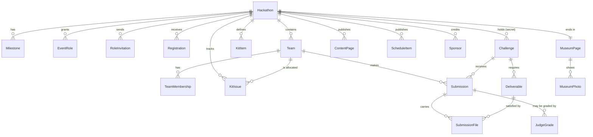
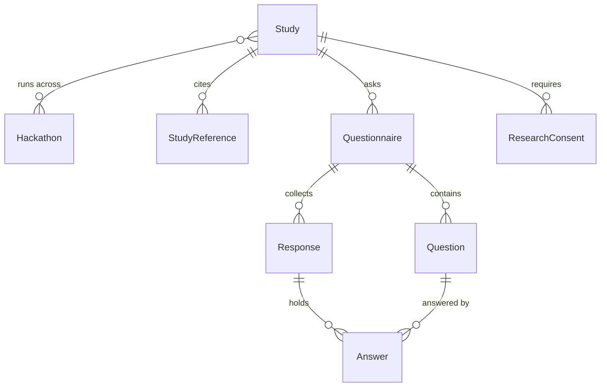

# CrashTech — data model

> **This is the approval gate.** Per the kickoff sequence in
> [building_an_app.md](../building_an_app.md), the data model is written on
> its own and waits for approval before the full spec or any code. It does
> not have to be final. It has to be understandable, and it has to make the
> shape of the thing arguable.
>
> Django app label: `crashtech`. Own models, own migrations from `0001`.
> The only thing shared with the rest of the site is `auth.User`, for
> sign-in and nothing else (Rule 2).

Companion to [spec.md](spec.md) chapter 1. Where this document and that
one disagree, this one is newer.

---

## The shape in one picture

---

## 1. The event and its milestones

### Hackathon

One event. The root of everything.

| Field | Type | Notes |
| --- | --- | --- |
| `name` | CharField | "CrashTech VLSI 2027" |
| `slug` | SlugField, unique | auto from name, stable forever since the museum page lives at it |
| `tagline` | CharField, blank | one line for the public page |
| `status` | choice | `setup` / `published` / `kits` / `live` / `closed` / `museum`. See below |
| `starts_at` / `ends_at` | DateTime | the 24 hours themselves |
| `submission_deadline` | DateTime | separate from `ends_at` on purpose: submissions can close before the event does |
| `team_size_max` | int, default 2 | **How many people may be on one team.** `1` means the event is individual. There is no ceiling in the model: 2, 3, 5, 100 are all legal, because the right number is an organiser's decision, not the software's |
| `kits_per_team` | int, default 1 | How many kits a team is allocated. One board between a team is the normal case; an event that wants one each sets this higher |
| `repo_url` | URLField, blank | pointer to the supporting repo: examples, skills, methodology. **A URL and nothing more**, so a repo reused across several events costs nothing and a fresh one per event is equally fine. Never holds challenges |
| `timezone` | CharField | an event is a physical place; a UTC-only model gets the pickup day wrong |
| `leaderboard_visibility` | choice | `admins` (default) / `participants` / `public`. **A setting, not a policy**: an admin opens the board up when they want to, including onto a screen in the room, and it stays shut otherwise |
| `results_published_at` | DateTime, null | when an admin published. Until then the standings exist and almost nobody may see them |
| `created_at` | DateTime | |

**Status is the spine.** Every surface in the app gates on it, and it is the
one piece of the 2026 platform that survives untouched because it was right.

| Status | What is true |
| --- | --- |
| `setup` | Nothing is public. Tech lead authors challenges, admin configures. |
| `published` | Milestone 1. The event page is public, sign-up is open, challenges invisible. |
| `kits` | Milestone 2. Hardware is being handed out, the supporting repo is open, challenges still invisible. |
| `live` | Milestone 3. Entering this state **makes every challenge visible at once**. Submissions accepted. |
| `closed` | Milestone 4. Submissions locked. Judges shortlist, grade and verify. Standings still private. |
| `museum` | Milestone 5. **Results published.** Permanent, public, terminal. |

**Advancing from `closed` to `museum` is the act of publishing**, and it is
the single most meaningful click an admin makes. It is one action with
three effects: the final standings become public, the museum opens, and
both stay that way forever. It is therefore gated (§7, "Publishing is
gated") rather than available whenever somebody feels like it.

### Milestone

Milestones were narrative until a questionnaire needed to attach to one.
Now they are rows.

| Field | Type | Notes |
| --- | --- | --- |
| `hackathon` | FK | CASCADE |
| `kind` | choice | `publication` / `hardware` / `kickoff` / `close` / `museum`, plus `custom` |
| `title` | CharField | shown to people; "Kit pickup day" |
| `occurs_at` | DateTime | **this is where the hardware pickup date lives** |
| `order` | int | |
| `blurb` | TextField, blank | what happens at this moment |

Why this exists rather than four more date fields on `Hackathon`: a
questionnaire attaches to a milestone (§8), the public page lists them as a
timeline, and the calendar export (§4) is a loop over them. Fixed dates
could not carry any of that. The gap between any two is whatever the dates
say, so "two weeks, or one week, or three days" needs no special support.

---

## 2. People and roles

### EventRole

A role grant, scoped to one event. A person may hold several on one event
and different ones across events.

| Field | Type | Notes |
| --- | --- | --- |
| `hackathon` | FK | CASCADE |
| `user` | FK `auth.User` | CASCADE. The one shared thing (Rule 2) |
| `role` | choice | `tech_lead` / `admin` / `judge` / `participant` / `researcher` |
| `granted_by` | FK User, null | who let them in |
| `created_at` | DateTime | |

Unique on (`hackathon`, `user`, `role`).

**`tech_lead` and `admin` are separate, and that is the main structural
change from 2026**, where one "organizer" owned both the challenges and the
logistics. They are different **jobs**: one defines the hardware, the
example, the secret challenges and the judging criteria; the other handles
sign-ups, kits, announcements and process.

**They are not necessarily different people.** One person may hold both,
and on a small event usually will. The unique constraint is on
(`hackathon`, `user`, `role`), so holding two roles is two rows and costs
nothing. Separating the roles is about keeping the *permissions* and the
*screens* distinct, so that an event with two people can split the work
cleanly; it never forces an event with one person to pretend to be two.

### RoleInvitation

**Added by the UX review** ([user_journeys.md](user_journeys.md) §4.1). An
admin's first real task is appointing a tech lead and judges, and those are
busy outsiders who have never heard of this site. `EventRole` can only
point at a `User`, so without this the admin's first action waits on three
prior steps by somebody else.

| Field | Type | Notes |
| --- | --- | --- |
| `hackathon` | FK | CASCADE |
| `email` | EmailField | who is being invited |
| `role` | choice | the same choices as `EventRole` |
| `invited_by` | FK User | |
| `token` | CharField, unique | in the link |
| `sent_at` | DateTime | |
| `accepted_at` | DateTime, null | |
| `accepted_user` | FK User, null | who redeemed it |

Unique on (`hackathon`, `email`, `role`). Redeeming creates the matching
`EventRole`, and the invitation stays as the record of who invited whom.

It also makes **invited but not joined** a visible state, which is the one
that matters two days before an event when a judge has not appeared.

### Registration

**New.** In 2026 a participant was *invited* by an organizer. Milestone 1
says people sign up themselves, so applying and being accepted are two
different events and need somewhere to live.

| Field | Type | Notes |
| --- | --- | --- |
| `hackathon` | FK | CASCADE |
| `user` | FK User | CASCADE |
| `status` | choice | `applied` / `accepted` / `declined` / `withdrawn` |
| `applied_at` | DateTime | |
| `decided_at` / `decided_by` | DateTime / FK User, null | |
| `note` | TextField, blank | what they wrote when applying, or why they were declined |

Unique on (`hackathon`, `user`). Accepting a registration is what grants the
`participant` `EventRole`; the two are kept apart so "who asked" survives
independently of "who is in".

### Team

A team is **one or more people**, up to `Hackathon.team_size_max`, which an
admin sets per event and which defaults to 2. Setting it to 1 makes the
event individual. Nothing in the model caps it.

| Field | Type | Notes |
| --- | --- | --- |
| `hackathon` | FK | CASCADE |
| `name` | CharField, blank | optional. A team may name itself; a one-person team usually will not |
| `members` | M2M User **through `TeamMembership`** | see below: the plain M2M was wrong |
| `anon_ordinal` | int | stable anonymous label for blind judging: "Team 7" |
| `exhibition_consent` | bool | for the museum, captured up front, revocable after |
| `created_at` | DateTime | |

**There is no captain and no hierarchy.** Every member holds every
authority: any of them may submit, upload, collect the kit, or change
anything the team owns. That removes a field, a permission check, and an
argument at 4am.

A team of one is still a team. That sounds like pedantry and is not: it is
what stops the leaderboard, the certificates, the blind judging and the
museum from each having to ask whether they are looking at a person or a
group.

**Individual behaviour survives teamwork.** The research is about
individuals, and a team could have hidden who did what. It does not:
`Submission.submitted_by` records the individual who acted,
`KitIssue.collected_by` records who physically took the hardware,
`ResearchConsent` is per user, and questionnaire responses are per user.
**The team is how work is scored; the person is how behaviour is measured.**

### TeamMembership

The plain `M2M User` in the first draft was a real defect, and the question
"can a user be in a few teams?" is exactly the one that exposes it. A bare
M2M says yes, with no limit, in any event. That is wrong in one direction
and right in the other:

- **Within one hackathon, a person belongs to exactly one team.** Two teams
  in the same event would mean two scores for one person, two kits, and a
  leaderboard that cannot be read.
- **Across hackathons, a person belongs to many teams.** Someone who
  competes three years running has three, and that is the whole point of a
  platform rather than one event.

A plain M2M cannot express that, because the constraint is on
(hackathon, user) and the join table only knows about (team, user). So the
relationship gets an explicit through model carrying the hackathon:

| Field | Type | Notes |
| --- | --- | --- |
| `team` | FK Team | CASCADE |
| `user` | FK User | CASCADE |
| `hackathon` | FK Hackathon | denormalised from `team`, and the only reason this model exists |
| `joined_at` | DateTime | |

**Unique on (`hackathon`, `user`).** The database refuses the second team
rather than a view remembering to check. The denormalised `hackathon` is
not redundancy for convenience, it is the only way to put the constraint
where it cannot be forgotten.

---

## 3. Hardware

Entirely new. The 2026 platform had one integer, `hardware_stock`, and a
three-state flag on the team. It could not express *what* the hardware was,
so it could never be swapped for a Raspberry Pi.

### KitItem

What the kit is made of, **defined by the tech lead per event**.

| Field | Type | Notes |
| --- | --- | --- |
| `hackathon` | FK | CASCADE |
| `name` | CharField | "Intel DE10-Lite", "ESP32-WROOM-32", "SSD1306 OLED" |
| `description` | TextField, blank | markdown |
| `image` | ImageField, blank | |
| `quantity_total` | int | how many exist |
| `is_returnable` | bool | a dev board comes back, a jumper wire does not |
| `order` | int | |

The event's kit is simply its list of `KitItem`s. Next year that list says
Raspberry Pi and nothing in the code changes.

### KitIssue

| Field | Type | Notes |
| --- | --- | --- |
| `hackathon` | FK | CASCADE |
| `team` | FK Team | **allocated to the team.** `Hackathon.kits_per_team` says how many, default 1 |
| `item` | FK KitItem, null | null means "the whole kit" |
| `status` | choice | `reserved` / `collected` / `returned` / `lost` |
| `collected_by` | FK User, null | **which member physically took it.** Any member may; there is no captain |
| `collected_at` | DateTime, null | |
| `confirmed_by` | FK User, null | **the admin who approved receipt** |
| `note` | TextField, blank | |

**Allocation and collection are two different things, and the model keeps
them apart.** The kit belongs to the **team**: one per team by default,
`kits_per_team` if the event wants more. It is picked up **in person by one
of the members**, any of them, and whoever that was is recorded. So the
stock arithmetic counts teams, the queue at the desk counts people, and
both are answerable from the same row.

Recording `collected_by` is not bookkeeping for its own sake. The research
is about individuals, and "who actually turned up to fetch the hardware" is
a behavioural fact that would otherwise be lost the moment the kit became a
team asset.

**Consequence worth stating:** because kits are allocated to teams, **teams
must exist by the hardware milestone.** Team formation is therefore part of
registration or of milestone 2, not something deferred to the event. That
is a scheduling fact, not a technical one, and it is the cost of one kit
per team rather than one per person.

Sizing follows: available kits is `stock - (teams x kits_per_team)`.

**No shipping.** Kits are handed over at a place on a date. International
means the audience is international and travels to the event; it does not
mean posting FPGA boards across borders, with the addresses, tracking and
customs that would require. If that ever changes, `KitIssue` grows a
delivery method and `Registration` grows an address, and nothing else moves.

---

## 4. Content: the static site, absorbed

The 2026 site was eight sections of hand-written HTML. What survives into
the database is only what is **specific to this event and not in the repo**:
what the event is, its rules, its schedule, its sponsors. The consequence is
the one that matters: **running the next event needs no developer.**

### ContentPage

| Field | Type | Notes |
| --- | --- | --- |
| `hackathon` | FK | CASCADE |
| `slug` | SlugField | `about`, `rules`, `venue`, `faq`. **Not** `hardware` or `get-started`: those are the repo's |
| `title` | CharField | |
| `body` | TextField | markdown |
| `visible_from` | choice, null | the milestone kind it appears at; null means always |
| `order` | int | |
| `published` | bool | |

**Deliberately narrow.** The 2026 site had eight sections; only some become
`ContentPage` rows. What the event is, the rules, how to register, and
anything else specific to *this* event lives here. The hardware guide, the
setup checklist, the AI tooling guidance and the practice projects do
**not**: they live in the supporting repo, and the system links to it
rather than restating it. One source, so the two cannot drift apart.

### ScheduleItem

Structured rather than prose, because it drives the calendar.

| Field | Type | Notes |
| --- | --- | --- |
| `hackathon` | FK | CASCADE |
| `title` | CharField | "FPGA Installation Party" |
| `description` | TextField, blank | |
| `starts_at` / `ends_at` | DateTime / DateTime null | |
| `location` | CharField, blank | |
| `order` | int | |

Milestone 1 said people get a calendar. The ICS export is a loop over
`Milestone` plus `ScheduleItem`, which is why both are structured and
neither is a paragraph of markdown.

### Sponsor

| Field | Type | Notes |
| --- | --- | --- |
| `hackathon` | FK | CASCADE |
| `name` | CharField | |
| `logo` | ImageField | |
| `url` | URLField, blank | |
| `tier` | CharField, blank | "platinum", or blank if tiers are not used |
| `order` | int | |

The 2026 site carried ten logos as static files. Per event, because next
year's sponsors are next year's problem.

## 5. Challenges

### Challenge

| Field | Type | Notes |
| --- | --- | --- |
| `hackathon` | FK | CASCADE |
| `title` | CharField | |
| `brief` | TextField | markdown, the full task |
| `kind` | choice | `completion` / `measured` / `creativity`. The three you described |
| `points` | int | what `completion` is worth |
| `visible` | bool | **false until kickoff.** Carried over unchanged |
| `order` | int | |
| `created_by` | FK User, null | the tech lead |

**Measured challenges** (the one real product change from the 2026
feedback) add:

| Field | Type | Notes |
| --- | --- | --- |
| `metric_name` | CharField, blank | "Fmax", "logic elements", "cycles" |
| `metric_unit` | CharField, blank | "MHz", "count", "ms" |
| `metric_direction` | choice | `higher_is_better` / `lower_is_better` |
| `rank_points` | JSONField | points by finishing position, e.g. `[50, 30, 20, 10]` |

**Creativity challenges** add:

| Field | Type | Notes |
| --- | --- | --- |
| `max_grade` | int | what a judge may award |
| `criteria` | TextField, blank | what the judges are told to look for |

A measured challenge ranks teams by their reported number and pays by
position. A creativity challenge pays by human grade. A completion
challenge pays a flat `points` on self-report. They are one model with three
modes rather than three models, because a submission is the same shape in
all three cases.

### Deliverable

**New, and one of the two most important additions.** You said each task
defines in advance what has to be uploaded. In 2026 every submission had
exactly one zip field, identical for every challenge.

| Field | Type | Notes |
| --- | --- | --- |
| `challenge` | FK | CASCADE |
| `label` | CharField | "Quartus project", "ESP32 firmware", "Demo video" |
| `purpose` | choice | `proof` (it worked) / `artifact` (how it was built) |
| `kind` | choice | `video` (**a URL, never an upload**) / `image` / `text` / `number` / `file` |
| `required` | bool | |
| `help_text` | CharField, blank | |
| `order` | int | |

Because the requirement is declared, the system can tell a team what is
still missing **before** they submit. That saves a judge an argument at 3am
and costs nothing.

---

## 6. Submissions, and the trust model

### Submission

| Field | Type | Notes |
| --- | --- | --- |
| `challenge` | FK | CASCADE |
| `team` | FK Team | CASCADE |
| `submitted_by` | FK User, null | who pressed it |
| `reported_value` | DecimalField, null | **the measured number the team reports** |
| `reported_note` | TextField, blank | the text result, or how they got it |
| `claimed_complete` | bool | for `completion` challenges |
| `tentative_points` | int | **awarded immediately, on trust. Always 0 for `creativity` challenges**, which have no number to report and cannot be self-assessed |
| `final_points` | int, null | set when results are confirmed; null until then |
| `verification` | choice | `unverified` / `verified` / `disputed` / `withdrawn` |
| `verified_by` / `verified_at` | FK User null / DateTime null | the spot check |
| `verification_note` | TextField, blank | |
| `is_finalist` | bool | **shortlisted for judging.** See below |
| `finalist_set_by` / `finalist_set_at` | FK User null / DateTime null | |
| `created_at` / `updated_at` | DateTime | |

Unique on (`challenge`, `team`).

**This is the inversion from 2026 and the single most important behavioural
decision in the model.** The old `Submission` started `pending` with zero
points and waited for a judge to approve before it scored anything. This one
**scores on submission** and treats verification as a later, optional,
narrow act aimed only at the scores that decide the outcome. `verification`
defaults to `unverified` and that is a normal, final, respectable state for
the great majority of submissions. Nothing blocks on a judge.

**With one exception, and it is not an exception to trust.** A
`creativity` challenge scores **only** on a judge's grade (`JudgeGrade`,
§7). Its `tentative_points` are always zero, and it carries no score at all
until judging finishes after the event.

That is not distrust, it is arithmetic. Trust works for the other two kinds
because there is something to report and something to check later: a
completion challenge has "it worked", a measured challenge has a number and
an artifact that either supports it or does not. **Creativity has neither.**
There is no self-reported value that could be right or wrong, and nothing a
spot check could compare against afterwards. A team cannot report its own
originality any more than it could report its own place in the final
standings.

So the board moves live for completion and measured work, and the creativity
scores land when judges grade them. Teams should be told that plainly on the
challenge itself, because a submitted creativity challenge showing zero points is
otherwise indistinguishable from a bug.

### SubmissionFile

| Field | Type | Notes |
| --- | --- | --- |
| `submission` | FK | CASCADE |
| `deliverable` | FK Deliverable | which requirement this satisfies |
| `file` | FileField, null | stored on GCS, never the app disk (§9). Size-capped |
| `text_value` | TextField, blank | for `text` and `number` deliverables |
| `url` | URLField, blank | **the only way a video is ever provided** (§9). Also usable for any other deliverable somebody hosts elsewhere |
| `thumbnail_url` | URLField, blank | captured at submission time for a `video`, so the museum degrades to a still image when somebody deletes their video in a year |
| `uploaded_at` | DateTime | |

Deleting a row deletes its file. memz learned this the expensive way: every
delete path left the bytes on a 1 GB shared disk, and video is far bigger
than a meme.

### UploadToken

Carried over from 2026 because it solves a real problem: a phone filming a
demo at 3am should not have to log in.

| Field | Type | Notes |
| --- | --- | --- |
| `team` | FK Team | CASCADE |
| `challenge` | FK Challenge | CASCADE |
| `token` | CharField, unique | in the QR code |
| `expires_at` | DateTime | |

---

## 7. Judging, results, museum

### JudgeGrade

Creativity challenges need a human number, and more than one judge may
grade the same submission.

| Field | Type | Notes |
| --- | --- | --- |
| `submission` | FK | CASCADE |
| `judge` | FK User | CASCADE |
| `grade` | int | |
| `note` | TextField, blank | |
| `created_at` | DateTime | |

Unique on (`submission`, `judge`).

**Judging happens after the event, never during it.** `JudgeGrade` rows can
only be created while the hackathon is `closed`. During the 24 hours judges
have nothing to do, which is deliberate: a judge grading live would be
scoring work against a moving field, and the earliest submission would be
judged on a different standard from the last.

### Publishing is gated

Advancing `closed` to `museum` publishes the standings permanently, so it
is refused until the results are actually final:

- every **finalist** has at least one `JudgeGrade`
- no submission is left in `disputed`
- every creativity challenge with submissions has a shortlist

Like readiness (user_journeys.md §4.2) this is **computed, not stored**. The
admin sees what is outstanding and a link to each, and the publish action
appears when nothing is. The confirmation states the irreversible part:
*"The final standings become public and the museum opens. Both are
permanent."*

### The leaderboard is not a model

It is computed from submissions, exactly as memz computes its podium from
votes. A stored total is a second source of truth for a number that is only
ever read, and it goes stale the moment a verification changes a score.

### Certificate

| Field | Type | Notes |
| --- | --- | --- |
| `hackathon` / `team` | FK / FK | |
| `type` | choice | `participation` / `winner` / `runner_up` |
| `cert_id` | UUID, unique | the public link |
| `generated_at` | DateTime | |

### MuseumPage and MuseumPhoto

| MuseumPage | Type | Notes |
| --- | --- | --- |
| `hackathon` | OneToOne | |
| `published` | bool | |
| `highlights` | TextField | markdown |
| `published_at` | DateTime, null | |

| MuseumPhoto | Type | Notes |
| --- | --- | --- |
| `museum_page` | FK | CASCADE |
| `image` | ImageField | **stored externally, never on the app disk.** See §9 |
| `caption` | CharField, blank | |
| `uploaded_by` | FK User, null | null for the admin's own curated set |
| `moderation_status` | choice | `pending` / `approved` / `rejected` |
| `order` | int | |
| `created_at` | DateTime | |

**The museum is participatory, not curated-only.** Once published, anyone
signed in may add photos and anyone at all may download them. That is the
point: the people who were there have the good pictures, and the admin has
twenty of the four hundred that exist.

Two consequences follow and neither is optional. **Moderation**, because a
permanent public page anyone can post to is a permanent public page anyone
can post anything to; CrashTech reaches the site's existing safety check
through a single named adapter, the same shape `memz/moderation.py` already
uses (Rule 2). And **storage**, which is section 9, because this is the
decision that can take the whole site down.

The exhibition of projects is **computed**, not stored: the submissions of
teams that gave `exhibition_consent`. No separate table, and revoking
consent removes the work from display without deleting anything.

---

## 8. Research

The part with the most care in it, because it is about people.

### Study

| Field | Type | Notes |
| --- | --- | --- |
| `title` | CharField | |
| `description` | TextField | the short version: what is being studied |
| `thesis` | TextField, blank | **the research thesis.** The claim the study is actually testing, written out, not a topic label |
| `research_questions` | TextField, blank | markdown. The questions the thesis breaks down into, which is what the questionnaires are built from |
| `literature_review` | TextField, blank | **the deep literature study**, markdown, long-form. Lives with the study rather than in a drive folder, so it is still attached when somebody reads the results in three years |
| `literature_updated_at` | DateTime, null | a literature review decays; this says when it was last touched |
| `researchers` | M2M User | |
| `hackathons` | M2M Hackathon | **a study spans events**, which is how behaviour across events gets compared |
| `consent_text` | TextField | what a participant agrees to, in full |
| `consent_version` | CharField | changing the terms must not silently reuse old consent |
| `ethics_reference` | CharField, blank | the Technion approval, when there is one |
| `is_active` | bool | |

Note that `Study` is **not** a child of `Hackathon`. Everything else in this
model belongs to one event; a study deliberately does not, because the
research question is about events plural.

**Why the thesis and the literature study live in the database rather than
in a document somewhere.** A study that spans three events spans three
years, and the thing most likely to be lost in that time is the reasoning:
why these questions, what was already known, who had asked before. Keeping
the thesis and the review next to the data they produced means the answer
and its justification cannot be separated. It also means the museum page and
any published write-up can draw on them without someone re-finding a file.

### StudyReference

A literature study is a set of sources, and a `TextField` full of pasted
citations is the "JSON file as real data" mistake in prose form (Rule 1).

| Field | Type | Notes |
| --- | --- | --- |
| `study` | FK Study | CASCADE |
| `citation` | TextField | the full reference as it should be rendered |
| `url` | URLField, blank | |
| `doi` | CharField, blank | |
| `year` | int, null | |
| `note` | TextField, blank | why this one matters to the thesis, which is the part a bibliography always loses |
| `order` | int | |

### Questionnaire, Question, Response, Answer

| Questionnaire | Type | Notes |
| --- | --- | --- |
| `study` | FK | CASCADE |
| `milestone_kind` | choice | **when it is asked.** The reason `Milestone` is a model |
| `title` / `intro` | CharField / TextField | |
| `is_open` | bool | |

| Question | Type | Notes |
| --- | --- | --- |
| `questionnaire` | FK | CASCADE |
| `text` | TextField | |
| `kind` | choice | `text` / `scale` / `single_choice` / `multi_choice` / `number` |
| `choices` | JSONField | for the choice kinds |
| `required` | bool | |
| `order` | int | |

| Response | Type | Notes |
| --- | --- | --- |
| `questionnaire` | FK | CASCADE |
| `hackathon` | FK | which event this answer came from |
| `user` | FK User, null | **null when the study is anonymised** |
| `submitted_at` | DateTime | |

| Answer | Type | Notes |
| --- | --- | --- |
| `response` | FK | CASCADE |
| `question` | FK | |
| `value` | TextField | |

### ResearchConsent

| Field | Type | Notes |
| --- | --- | --- |
| `study` | FK | CASCADE |
| `user` | FK User | CASCADE |
| `hackathon` | FK | the event at which it was given |
| `granted` | bool | |
| `consent_version` | CharField | the exact terms agreed to |
| `granted_at` | DateTime | |
| `withdrawn_at` | DateTime, null | |

Unique on (`study`, `user`, `hackathon`).

**Why this is its own model and exists from day one.** The 2026 platform had
one consent flag, for publishing team photos. Research consent is a
different promise: what is collected, what it is for, whether it is
identifiable, and whether someone can withdraw later and have their data
excluded. Consent is the only thing in this entire model that **cannot be
added afterwards**, because data collected without it cannot be made usable
retroactively. The version field exists so that changing the terms does not
silently inherit agreement to the old ones.

---

## 9. Where the media lives

**This is the decision most likely to break the site, and it is not a
preference.** It belongs in the data model because it determines what every
`FileField` and `ImageField` above actually does.

### The arithmetic

The whole site runs on one Render instance with a **1 GB persistent disk**,
shared by babook, matazim, memz, ustrip and sensorlab. Against that, an
event of 24 teams and 10 challenges:

| What | If uploaded | Note |
| --- | --- | --- |
| Demo videos, raw phone capture | **~26 GB** | twenty-five times the whole site's disk |
| Demo videos, compressed 720p | ~6 GB | still six times the disk |
| Museum photos, raw 12MP, 300 of them | ~1.0 GB | one event fills the disk |
| Museum photos, resized 1600px q82 | ~94 MB | fine |
| Source artifacts, ~2 MB a zip | ~480 MB | |

**Video is the entire problem.** The museum photos everyone worries about
are a rounding error beside it.

### Decision 1: a video deliverable is a URL. There is no upload path.

The strongest version of "ask for a link", and stronger than demanding
YouTube specifically: **the system stores a URL and never accepts video
bytes at all.**

YouTube, Vimeo, a Drive share, anything. The system does not care, which
is what makes this work: "you must have a Google account" would be a real
barrier for an international audience at 3am, and "paste a link to your
video, wherever it lives" is not.

The consequences are all good:

- **Zero bytes stored.** 26 GB becomes 0.
- **No upload machinery to build, and none to abuse.** If the path does
  not exist, nobody uses it and nobody has to police it.
- **Better playback than we could offer.** Transcoding, adaptive bitrate,
  mobile, someone else's bandwidth.
- **It outlives our bucket.**

Two things to handle rather than pretend away:

- **Tell them at kit pickup, not at the deadline.** Demanding a hosted
  video is only fair if it is knowable two weeks ahead, and milestone 2 is
  exactly when people are being told how the event works. At 3am it would
  be a trap.
- **Links die.** Somebody deletes their video in a year and the museum has
  a hole in it, permanently. Where the URL is a YouTube or Vimeo one the
  thumbnail is derivable, so **capture it at submission time** and the
  museum degrades to a still image rather than an empty box.

With this decision, the remaining storage is about **650 MB per event**,
or roughly **6 GB across ten events** — and the largest item in it is
source zips, not images.

### Decision 2: everything else goes to Google Cloud Storage

Still not the Render disk: 6 GB across ten events is six times the disk,
and the disk is shared with every other app here.

**This site already has GCS configured.** A service account and bucket
exist for `backup_db`, with `GCS_SERVICE_ACCOUNT` and `GCS_BUCKET` already
in the environment. No new vendor, no new account, no new credential.

Images are resized on upload (1600px long edge, q82, EXIF stripped) and
**source artifacts get a size cap**, because at 2 MB a zip they are now the
biggest thing stored and nothing stops somebody committing a Quartus output
directory.

Deleting a row deletes its file, on commit. A permanent public museum that
anyone can upload to cannot tolerate orphans, because nothing ever prunes
them.

### Decision 3: a separate bucket, and a correction

An earlier draft of this document said one bucket "cannot" be both private
and public. **That was overstated.** It is possible: per-object ACLs with
uniform access turned off, or IAM conditions granting public read on a
prefix like `crashtech/museum/*`, or keeping everything private and serving
through signed URLs.

The recommendation is still a **separate bucket**, but the reason is blast
radius rather than impossibility:

- A bucket is **free**. You pay for bytes and operations, never for the
  container. There is no cost to being careful here.
- The other bucket holds **database backups for the entire site**: every
  user, every app, every table.
- A mistaken prefix condition or a stray ACL is **silent**. Nothing fails,
  nothing logs, the backups are simply readable.
- Signed URLs would work and would keep one bucket, but they expire, and a
  museum exists to have its links shared and still work next year.

So: one command to create `crashtech-media`, public read, same service
account for writes. That is the whole of the extra work, and it removes a
class of mistake whose worst case is the site's entire database.

### Why not Google Drive

Drive was the first instinct and it is the wrong Google product for this:

- **Not built to serve a web page.** The `drive.google.com/uc?id=...`
  hotlink is unofficial, rate-limited, returns an HTML interstitial for
  larger files, and Google has broken it more than once.
- **No cache headers**, so every visitor re-fetches everything.
- **Per-file permissions** rather than a property of the container.
- **No maintained Django backend**; `django-storages` supports GCS as a
  first-class one.
- **Quota shared with Gmail and Photos** on a personal account.

Drive is a filing cabinet with a web page bolted on. GCS is what you serve
from, and it is the same Google account and the same bill.

### Cost

GCS Standard is about $0.020/GB/month, which `settings.py` already records.
Six gigabytes across ten events is about **twelve cents a month**. Egress is
about $0.12/GB and is the one place R2 or B2 would be cheaper; at this
volume, with no video stored at all, it does not matter.

Everything routes through `django-storages`, so if any of this ever stops
being true, moving is a settings change rather than a rewrite.

---

## Decisions already taken, and why

| Decision | Reason |
| --- | --- |
| No test harness, ever | Yours. Quartus on a backend is heavy lifting you do not want, and it is not the system's job |
| Points score immediately, on trust, **except creativity** | Yours. Completion and measured work score on self-report. Creativity scores only on a judge's grade, because there is no number to report and nothing a later spot check could compare against |
| Verification is a late, narrow, manual spot check | Yours. Only the scores that decide winners, done by judges, with the uploaded artifacts as the evidence that makes trust safe |
| Measured challenges are first class | Your choice of the three feedback options. The 8% who praised optimization challenges are the signal |
| The platform does not enforce the format | Your choice. Fewer and bigger challenges is a tech lead's authoring decision, not a rule in code |
| Content is per event, in the database | Yours. The next event needs no developer |
| Tech lead is separate from admin, but one person may be both | Yours. Separate *jobs*, not necessarily separate people. Two roles is two rows |
| The leaderboard is computed | Mine. A stored total is a second truth that goes stale on the first verification |
| Teams are any size, configurable, default 2 | Yours. `team_size_max` is an int, not a choice: 1 makes the event individual, and there is no ceiling. No captain: every member holds every authority |
| A kit is allocated to a team, collected by any member | Yours. `kits_per_team` defaults to 1. `collected_by` records which member turned up, which is a behavioural fact the research would otherwise lose. No shipping |
| Mentors are not in the system | Yours. They exist at the event; the software has no concept of them |
| The live leaderboard is a per-event setting, admins only by default | Yours. Shut unless an admin opens it, which keeps score-chasing off by default and still allows a board on the wall |
| English only, international, no Hebrew | Yours. No RTL and no bilingual templates, which is the most expensive thing to retrofit and the most often done badly. Costs every 2026 template, which was Hebrew |
| A study carries its thesis and its literature review | Yours. A study spanning three events spans three years, and the reasoning is what gets lost. `StudyReference` keeps the sources as rows, not as pasted text (Rule 1) |
| Membership is a through model, not a plain M2M | Yours, from the question. One team per person **per hackathon**, many across hackathons. A bare M2M cannot express that, because the constraint is on (hackathon, user) |
| Roles can be invited by email before the person has an account | Mine, from the UX review. `RoleInvitation`. Without it an admin cannot appoint the tech lead or the judges, who are the least patient people in the system |
| Results are published by an admin's click, once judging is final | Yours. One action, three permanent effects: standings public, museum open, both forever. Gated on judging being complete |
| Creativity is shortlisted, then graded, and only after the event | Yours. 72 submissions get a rubber stamp; 15 finalists get real attention. Judges cannot grade during the 24 hours |
| The museum takes uploads from anyone signed in | Yours. The people who were there have the good pictures. Needs moderation, which goes through one named adapter |
| User media never touches the Render disk | Mine, from the arithmetic. One event's raw demo videos are 26 GB against a 1 GB shared disk |
| A video deliverable is a URL; there is no upload path | Yours, taken further. Any host, not only YouTube, so nobody is blocked for lacking a Google account. Turns 26 GB into zero and removes the upload machinery entirely |
| Everything else goes to GCS, in a separate bucket | Yours (Google), refined to Cloud Storage rather than Drive, which cannot serve a web gallery. Separate bucket because the other one holds the whole site's database backups and a stray ACL is silent. Buckets are free |
| The repo is the only home for examples, skills and methodology | Yours. The system stores a URL and links. `PracticeProject` was dropped and `ContentPage` narrowed, because a database restating a repo is two sources that drift |

---

## Settled

Nothing is open. Every question raised during the interview has an
answer below.

| Question | Answer |
| --- | --- |
| Kit to a person or a team? | **A team.** One per team by default (`kits_per_team`), collected in person by any member |
| How many people on a team? | **Configurable per event, default 2.** `1` means individual; no upper limit. No captain |
| How is hardware delivered? | **Pickup only, in person.** No shipping, no addresses |
| Is `mentor` a role? | **No.** Removed from the role choices |
| Which language? | **English only, international.** No Hebrew, no RTL, no switcher |
| Can anyone watch the live leaderboard? | **A per-event setting**, `admins` by default, openable to participants or the public |
| Where do examples and methodology live? | **The repo.** `PracticeProject` dropped, `ContentPage` narrowed |
| Is there a captain? | **No.** Every member holds every authority |
